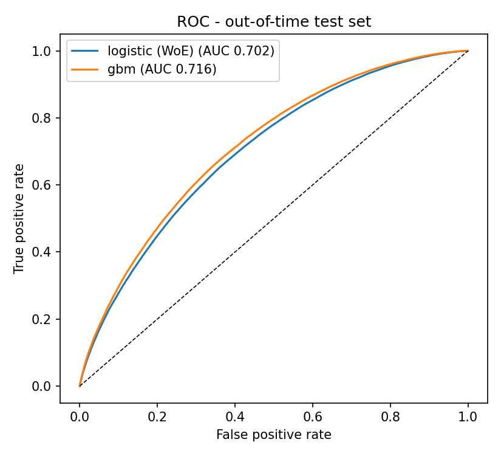
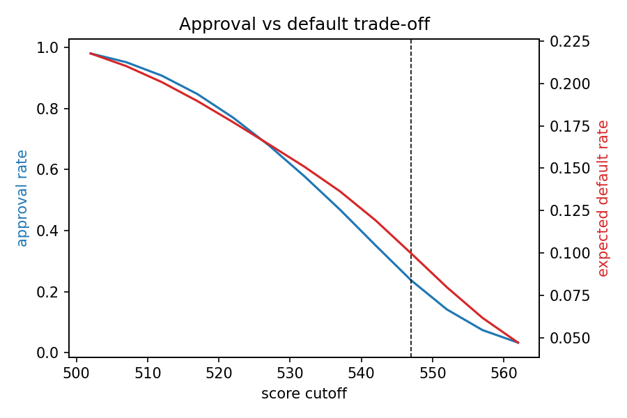

# Lending Club Credit Risk Scorecard

This project estimates default risk at loan origination and compares two approaches:
an interpretable Weight of Evidence logistic scorecard and a gradient-boosting
challenger. Both models are evaluated on later loan vintages, and the logistic model
is converted into credit points for approval-cutoff analysis.

## Results from the full-data run

The pipeline retained 1,348,099 loans with resolved outcomes. Loans issued before 2016
form the training sample; 2016 and later vintages form the 518,744-loan test sample.

| Model | Test AUC | Test Gini | Test KS |
| --- | ---: | ---: | ---: |
| WoE logistic scorecard | 0.7023 | 0.4046 | 0.2919 |
| Gradient boosting (scikit-learn HGB) | 0.7161 | 0.4323 | 0.3140 |

At a score cutoff of 547, the scorecard approves 23.7% of applicants with a 9.97%
expected default rate, versus a 22.42% default rate for the full portfolio.





```
data/        <- put the Kaggle CSV here (git-ignored)
src/
  make_sample_data.py   synthetic smoke-test data (NOT for reporting results)
  prepare.py            target, leakage removal, features, time split
  woe.py                WoE / IV binning
  metrics.py            AUC, Gini, KS, calibration, decile table, plots
  train_logistic.py     champion: WoE logistic regression
  train_gbm.py          challenger: LightGBM (or sklearn HistGradientBoosting)
  scorecard.py          points scorecard, score bands, cutoff trade-off
config.py               all settings in one place
run_all.sh              runs the four steps in order
outputs/                metrics (JSON), tables (CSV), plots (PNG)
```

## 1. Data

**Primary (recommended): Lending Club accepted loans 2007–2018Q4** — ~2.26M loans, 151 columns.

- Kaggle: <https://www.kaggle.com/datasets/wordsforthewise/lending-club>
  (file `accepted_2007_to_2018Q4.csv.gz`, ~400 MB; needs a free Kaggle account)
- Alternative Kaggle mirror with the same schema (2007–2015, ~890k loans, smaller):
  <https://www.kaggle.com/datasets/wendykan/lending-club-loan-data> (file `loan.csv`)
- Column dictionary (`LCDataDictionary.xlsx`) ships with both datasets — read it; it is
  what tells you which columns are post-origination.

Download, drop the file into `data/`, and `prepare.py` will find it automatically
(it looks for `accepted_2007_to_2018Q4.csv[.gz]` or `loan.csv`; see `config.RAW_CANDIDATES`).

**Lighter alternative** if you want something that runs in seconds:
UCI "Default of Credit Card Clients" (Taiwan, 30k rows):
<https://archive.ics.uci.edu/dataset/350/default+of+credit+card+clients>.
It has a different schema, so you would need to adapt `config.py` feature lists and
the target definition — the modelling code (`woe.py`, `metrics.py`, `scorecard.py`) is
dataset-agnostic.

## 2. Setup & run

```bash
python -m venv .venv && source .venv/bin/activate     # optional
pip install -r requirements.txt                       # lightgbm is optional
# smoke test with synthetic data (results are meaningless, pipeline check only):
python src/make_sample_data.py
./run_all.sh
# real run: delete data/sample_lending_club.csv, place the Kaggle file in data/, then
./run_all.sh
```

On the full 2007–2018 file, `prepare.py` takes a few minutes and ~8 GB RAM. If memory is
tight, read with `usecols=` (the feature lists in `config.py` are all you need) or use
the 2007–2015 mirror.

## 3. What each step does and why it matters in an interview

**Leakage control (`prepare.py`)** — `config.LEAKAGE_COLS` lists every column that is only
known *after* the loan is issued: payments received, recoveries, last FICO pull, hardship
and settlement flags, etc. Keeping any of these gives AUC > 0.9 and a model that is
useless at origination. This is the first thing a credit-risk interviewer will probe.

`sub_grade` is the one IV diagnostic flagged as "suspicious" (IV 0.503). It is available
at origination and is not outcome leakage, but it embeds Lending Club's own underwriting
model, so its unusually high predictive power is disclosed. Correlation filtering keeps
`sub_grade` while removing the redundant `grade` and `int_rate` variables.

**Out-of-time split** — train on vintages before `TEST_FROM_YEAR` (2016), test on 2016+.
Random splits flatter the model; banks validate on later vintages because that is how the
model will actually be used. Expect a small train→test drop; a large one means the
population has shifted.

**WoE / IV (`woe.py`)** — the standard scorecard methodology (Siddiqi, *Credit Risk
Scorecards*, 2006). WoE makes every feature monotone in log-odds and handles missing
values as their own bin; IV ranks predictive power. Features with IV < 0.02 are dropped;
IV > 0.5 is flagged as a leakage warning. Near-duplicate features (|ρ| > 0.9, e.g.
`grade` vs `sub_grade` vs `int_rate`) are reduced to the highest-IV one.

**Champion vs challenger (`train_logistic.py`, `train_gbm.py`)** — logistic on WoE is the
champion because it is interpretable, monotone, and convertible to a scorecard. GBM is
the challenger: it usually gains 1–3 AUC points on Lending Club but is harder to govern.
Both are reported on the same out-of-time test set with AUC, **Gini (= 2·AUC − 1)**,
**KS**, decile tables and a calibration plot.

**Scorecard (`scorecard.py`)** — converts logistic coefficients into points per bin with
PDO = 20, 600 points at 50:1 good:bad odds (standard FICO-style scaling). Outputs the
points table (`scorecard.csv`), observed default rate by 20-point score band, and an
approval-rate vs expected-default-rate curve. The script also picks an illustrative
cutoff (the one that halves the portfolio default rate) and prints the trade-off.

## 4. Expected results (real data, honest features)

| model | out-of-time AUC | Gini | KS |
|---|---|---|---|
| WoE logistic | ~0.68–0.71 | ~0.36–0.42 | ~0.27–0.32 |
| LightGBM | ~0.70–0.74 | ~0.40–0.48 | ~0.30–0.36 |

If you see AUC ≥ 0.85, you have leakage — check `iv_table.csv` for anything flagged
"suspicious" and `LCDataDictionary.xlsx` for the column's definition.

## 5. Outputs to put in the repo README / write-up

- `roc_comparison.png`, `calibration_comparison.png`, `ks_logistic.png`
- `score_bands.csv` (default rate by score band) and `score_distribution.png`
- `cutoff_tradeoff.png` + the one-line cutoff decision printed by `scorecard.py`
- `scorecard.csv` — the actual deliverable a lender would implement
- `iv_table.csv`, `gbm_feature_importance.csv`

## 6. Extensions if you have time

- Reject inference (the training data only contains *accepted* loans — a known bias; the
  `rejected_2007_to_2018Q4.csv` file in the same Kaggle dataset lets you discuss it).
- Population Stability Index (PSI) between train and test score distributions.
- Expected loss: PD × LGD × EAD using `recoveries` to estimate LGD *after* the fact.
- SHAP values on the GBM to show it agrees with the scorecard's drivers.

## References

- Siddiqi, N. (2006). *Credit Risk Scorecards: Developing and Implementing Intelligent
  Credit Scoring.* Wiley. — the WoE/IV/PDO methodology used here.
- Lending Club data dictionary (ships with the Kaggle dataset).
- scikit-learn `calibration_curve`, `roc_curve`; LightGBM docs.
